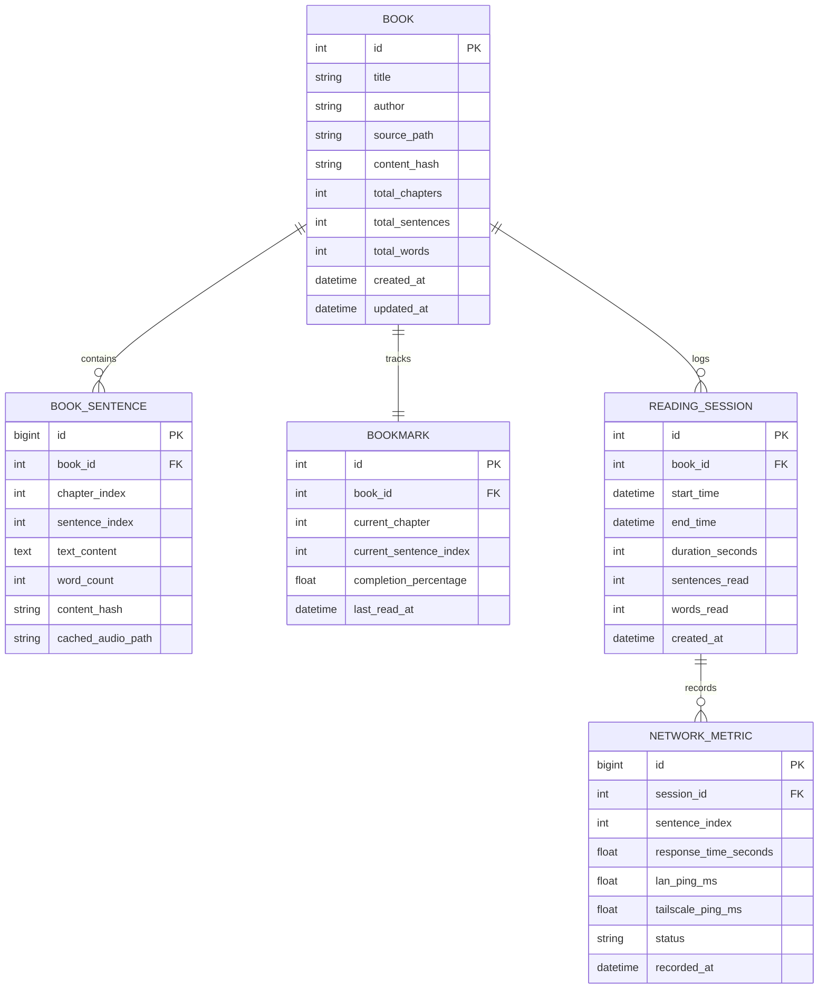

# Data Model: Core Audiobook Ingestion, Session Tracking, and Audio Player

**Feature**: `001-core-audiobook-player`
**Date**: 2026-11-20
**Database Engine**: MySQL 8.0+ / MariaDB 10.5+

## Relational Schema Diagram (Mermaid)

---

## Table Definitions & Validation Rules

### 1. `books`
Stores cataloged books and documents ingested into the application.

| Column | Type | Constraints | Description |
|---|---|---|---|
| `id` | `INT` | `AUTO_INCREMENT, PRIMARY KEY` | Internal unique surrogate identifier |
| `title` | `VARCHAR(255)` | `NOT NULL` | Extracted title or filename |
| `author` | `VARCHAR(255)` | `DEFAULT 'Unknown'` | Author name if detected or supplied |
| `source_path` | `VARCHAR(1024)` | `NOT NULL` | Absolute or relative file path on disk |
| `content_hash` | `CHAR(64)` | `NOT NULL, UNIQUE` | SHA-256 hash of original file content |
| `total_chapters` | `INT` | `NOT NULL, DEFAULT 1` | Count of parsed chapters |
| `total_sentences` | `INT` | `NOT NULL, DEFAULT 0` | Total segmented sentences |
| `total_words` | `INT` | `NOT NULL, DEFAULT 0` | Total words across all sentences |
| `created_at` | `DATETIME` | `NOT NULL, DEFAULT CURRENT_TIMESTAMP` | Ingestion timestamp |
| `updated_at` | `DATETIME` | `NOT NULL, DEFAULT CURRENT_TIMESTAMP ON UPDATE CURRENT_TIMESTAMP` | Last updated timestamp |

- **Validation Rules**:
  - `total_words >= 0`, `total_sentences >= 0`.
  - Duplicate ingestion check: `content_hash` prevents duplicate insertions of identical books.

---

### 2. `book_sentences`
Stores sequentially indexed, parsed speech units for each book.

| Column | Type | Constraints | Description |
|---|---|---|---|
| `id` | `BIGINT` | `AUTO_INCREMENT, PRIMARY KEY` | Unique sentence row identifier |
| `book_id` | `INT` | `NOT NULL, FOREIGN KEY (books.id) ON DELETE CASCADE` | Parent book reference |
| `chapter_index` | `INT` | `NOT NULL, DEFAULT 1` | 1-based chapter number |
| `sentence_index` | `INT` | `NOT NULL` | 0-based sequential sentence index |
| `text_content` | `TEXT` | `NOT NULL` | Cleaned sentence text ready for TTS |
| `word_count` | `INT` | `NOT NULL` | Words in this specific sentence |
| `content_hash` | `CHAR(64)` | `NOT NULL` | SHA-256 of `text_content` |
| `cached_audio_path` | `VARCHAR(1024)` | `DEFAULT NULL` | Local audio path if pre-cached |

- **Indexes**:
  - `UNIQUE KEY uk_book_sentence (book_id, sentence_index)`
  - `INDEX idx_book_chapter (book_id, chapter_index)`

---

### 3. `bookmarks`
Maintains the single source of truth for the reader's current location in each book.

| Column | Type | Constraints | Description |
|---|---|---|---|
| `id` | `INT` | `AUTO_INCREMENT, PRIMARY KEY` | Bookmark record ID |
| `book_id` | `INT` | `NOT NULL, UNIQUE, FOREIGN KEY (books.id) ON DELETE CASCADE` | Target book (1:1 relation) |
| `current_chapter` | `INT` | `NOT NULL, DEFAULT 1` | Current chapter number |
| `current_sentence_index` | `INT` | `NOT NULL, DEFAULT 0` | 0-based sentence index to resume |
| `completion_percentage` | `FLOAT` | `NOT NULL, DEFAULT 0.0` | Progress (0.0 to 100.0) |
| `last_read_at` | `DATETIME` | `NOT NULL, DEFAULT CURRENT_TIMESTAMP ON UPDATE CURRENT_TIMESTAMP` | Timestamp of latest progress save |

- **State Transitions**:
  - `New`: Created on book ingestion (`current_sentence_index = 0`, `completion_percentage = 0.0`).
  - `Reading`: Incremented on each sentence completed during active playback.
  - `Finished`: When `current_sentence_index == total_sentences - 1` (`completion_percentage = 100.0`).

---

### 4. `reading_sessions`
Records discrete study sessions for habit tracking and analytical visualization.

| Column | Type | Constraints | Description |
|---|---|---|---|
| `id` | `INT` | `AUTO_INCREMENT, PRIMARY KEY` | Session ID |
| `book_id` | `INT` | `NOT NULL, FOREIGN KEY (books.id) ON DELETE CASCADE` | Associated book |
| `start_time` | `DATETIME` | `NOT NULL` | Exact time playback started |
| `end_time` | `DATETIME` | `NOT NULL` | Exact time playback paused or quit |
| `duration_seconds` | `INT` | `NOT NULL, DEFAULT 0` | Active listening duration |
| `sentences_read` | `INT` | `NOT NULL, DEFAULT 0` | Sentences finished during this session |
| `words_read` | `INT` | `NOT NULL, DEFAULT 0` | Words absorbed during this session |
| `created_at` | `DATETIME` | `NOT NULL, DEFAULT CURRENT_TIMESTAMP` | Record creation timestamp |

- **Validation Rules**:
  - `end_time >= start_time`.
  - `duration_seconds = TIMESTAMPDIFF(SECOND, start_time, end_time)`.
  - `duration_seconds >= 0`, `words_read >= 0`.

---

### 5. `network_metrics`
Logs operational network and speech synthesis performance per sentence.

| Column | Type | Constraints | Description |
|---|---|---|---|
| `id` | `BIGINT` | `AUTO_INCREMENT, PRIMARY KEY` | Metric row ID |
| `session_id` | `INT` | `NOT NULL, FOREIGN KEY (reading_sessions.id) ON DELETE CASCADE` | Associated reading session |
| `sentence_index` | `INT` | `NOT NULL` | Sentence sequence index |
| `response_time_seconds` | `FLOAT` | `NOT NULL` | Duration of TTS API audio generation |
| `lan_ping_ms` | `FLOAT` | `DEFAULT NULL` | LAN gateway ping round-trip in ms |
| `tailscale_ping_ms` | `FLOAT` | `DEFAULT NULL` | Tailscale mesh round-trip in ms |
| `status` | `VARCHAR(32)` | `NOT NULL, DEFAULT 'SUCCESS'` | `SUCCESS`, `TIMEOUT`, `CACHE_HIT`, or `FAILED` |
| `recorded_at` | `DATETIME` | `NOT NULL, DEFAULT CURRENT_TIMESTAMP` | Metric recording timestamp |

- **Indexes**:
  - `INDEX idx_session_sentence (session_id, sentence_index)`
  - `INDEX idx_recorded_at (recorded_at)`
