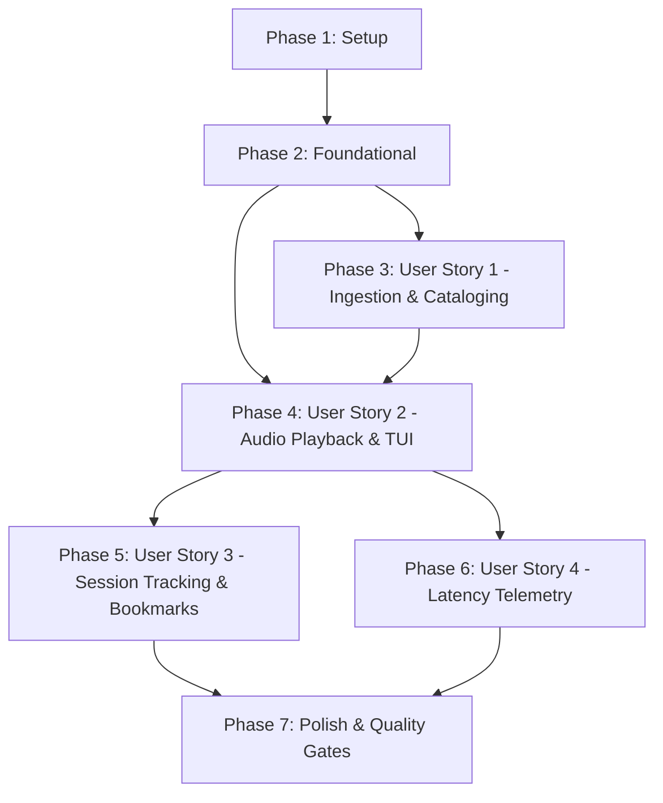

# Tasks: Core Audiobook Ingestion, Session Tracking, and Audio Player

**Input**: Design documents from `specs/001-core-audiobook-player/`
**Prerequisites**: [plan.md](file:///home/hai/Du_lieu_hoc_tap/Project/BTL_Python_Project/StudyLab/specs/001-core-audiobook-player/plan.md), [spec.md](file:///home/hai/Du_lieu_hoc_tap/Project/BTL_Python_Project/StudyLab/specs/001-core-audiobook-player/spec.md), [research.md](file:///home/hai/Du_lieu_hoc_tap/Project/BTL_Python_Project/StudyLab/specs/001-core-audiobook-player/research.md), [data-model.md](file:///home/hai/Du_lieu_hoc_tap/Project/BTL_Python_Project/StudyLab/specs/001-core-audiobook-player/data-model.md), [contracts/](file:///home/hai/Du_lieu_hoc_tap/Project/BTL_Python_Project/StudyLab/specs/001-core-audiobook-player/contracts/)

**Tests**: Test tasks are included per Constitution Principle II (Test-First & Automated Verification) requiring deterministic, 100% offline test coverage.

**Organization**: Tasks are grouped by user story to enable independent implementation and testing of each story.

---

## Phase 1: Setup (Shared Infrastructure)

**Purpose**: Project initialization, dependency management, and quality toolchain configuration.

- [x] T001 Create project package directory structure in src/ and tests/ per plan.md
- [x] T002 [P] Configure project dependencies and packaging in pyproject.toml and requirements.txt (edge-tts, pygame, sqlalchemy, pymysql, rich, readchar, pydantic, python-dotenv, pytest, pytest-mock)
- [x] T003 [P] Create environment configuration template in .env.example with defaults for database, TTS, ping hosts, and audio cache directory
- [x] T004 [P] Configure ruff linting/formatting and mypy strict type-checking in pyproject.toml

---

## Phase 2: Foundational (Blocking Prerequisites)

**Purpose**: Core infrastructure and database connection pooling that MUST be complete before ANY user story can be implemented.

**⚠️ CRITICAL**: No user story work can begin until this phase is complete.

- [x] T005 Implement centralized environment configuration loader in src/config.py using python-dotenv and Pydantic
- [x] T006 Implement database connection pool and engine manager in src/storage/db.py with pool_size=5, max_overflow=10, pool_pre_ping=True, and transaction context manager
- [x] T007 Implement database migration runner and DDL schema in src/storage/migrations.py for books, book_sentences, bookmarks, reading_sessions, and network_metrics tables
- [x] T008 [P] Implement core abstract TTSProvider protocol and AudioSynthesisResult dataclass in src/tts/base.py per contracts/tts-provider-contract.md
- [x] T009 [P] Implement MockTTSProvider and shared test fixtures in tests/conftest.py for deterministic offline test verification
- [x] T010 [P] Implement base CLI runner and entrypoint in src/cli/main.py with error handling and non-zero exit codes

**Checkpoint**: Foundation ready — user story implementation can now begin.

---

## Phase 3: User Story 1 - Text Ingestion and Library Cataloging (Priority: P1) 🎯 MVP

**Goal**: Ingest plain text (`.txt`) and Markdown (`.md`) documents, parse into chapters and indexed sentences with 35-word clause splitting, and store catalog metadata and indexed sentences in MySQL.

**Independent Test**: Run `python -m src.cli.main ingest sample.txt --title "Test Book"`; verify cataloged rows in `books`, `book_sentences`, and initial `bookmarks` tables.

### Tests for User Story 1

> **NOTE: Write these tests FIRST, ensure they FAIL before implementation**

- [x] T011 [P] [US1] Write unit tests in tests/unit/test_parser.py covering sentence tokenization, abbreviation filtering, and 35-word clause boundary splitting
- [x] T012 [P] [US1] Write integration tests in tests/integration/test_ingestion.py covering full book parsing, SHA-256 content hashing, and database cataloging

### Implementation for User Story 1

- [x] T013 [P] [US1] Create Book, BookSentence, and Bookmark models in src/models/book.py citing data-model.md: Book.title, Book.author, Book.source_path, Book.content_hash, Book.total_chapters, Book.total_sentences, Book.total_words, BookSentence.book_id, BookSentence.chapter_index, BookSentence.sentence_index, BookSentence.text_content, BookSentence.word_count, BookSentence.content_hash, BookSentence.cached_audio_path, Bookmark.book_id, Bookmark.current_chapter, Bookmark.current_sentence_index, Bookmark.completion_percentage
- [x] T014 [US1] Implement rule-based sentence tokenizer and clause-splitter in src/ingestion/parser.py supporting .txt/.md files with 35-word clause sub-segmentation
- [x] T015 [US1] Implement document loader and text normalizer in src/ingestion/reader.py
- [x] T016 [US1] Implement BookRepository and BookmarkRepository in src/storage/repositories.py with parameterized SQL queries for atomic book insertion and bookmark creation per contracts/storage-contract.md
- [x] T017 [US1] Implement IngestionService in src/ingestion/service.py orchestrating file reading, parsing, content hashing, and database persistence
- [x] T018 [US1] Wire ingest and list subcommands into CLI in src/cli/main.py supporting human-readable Rich table and structured --json output per contracts/cli-interface.md

**Checkpoint**: User Story 1 is fully functional and testable independently (MVP ready!).

---

## Phase 4: User Story 2 - Real-Time Audio Playback and Navigation (Priority: P1)

**Goal**: Synthesize speech sentence-by-sentence via Microsoft Edge-TTS default adapter, cache audio on local disk, stream playback via pygame.mixer lookahead buffer, and provide an interactive terminal UI with single-keystroke controls (`Space`, Arrows, `q`).

**Independent Test**: Run `python -m src.cli.main play <book_id>`; verify immediate audio playback, pause/resume on Space, sentence skipping on Left/Right arrows, speed control on Up/Down arrows, clean exit on `q`, and local audio caching under `.studylab/cache/audio/`.

### Tests for User Story 2

- [x] T019 [P] [US2] Write unit tests in tests/unit/test_tts_provider.py for EdgeTTSProvider and MockTTSProvider
- [x] T020 [P] [US2] Write unit tests in tests/unit/test_buffer.py for lookahead audio pre-fetch queue and disk caching

### Implementation for User Story 2

- [x] T021 [US2] Implement EdgeTTSProvider using Microsoft Edge-TTS with default voice in src/tts/edge_tts_adapter.py per contracts/tts-provider-contract.md
- [x] T022 [US2] Implement TTSFactory in src/tts/factory.py with provider resolution and test mock injection
- [x] T023 [US2] Implement local disk audio cache manager in src/player/cache_manager.py using SHA-256 sentence content hashing
- [x] T024 [US2] Implement lookahead audio buffer queue in src/player/buffer_manager.py pre-fetching sentence N+1 while sentence N plays
- [x] T025 [US2] Implement audio player controller in src/player/audio_player.py managing pygame.mixer headless playback, pause, resume, speed multiplier, and track end detection
- [x] T026 [US2] Implement interactive Terminal UI in src/cli/player_view.py using rich.live and readchar for real-time sentence display, progress bar, and hotkeys (Space, Arrows, q)
- [x] T027 [US2] Wire play subcommand into CLI in src/cli/main.py integrating buffer manager, audio player, and interactive TUI per contracts/cli-interface.md

**Checkpoint**: User Stories 1 and 2 are functional; users can ingest books and listen with full interactive TUI navigation.

---

## Phase 5: User Story 3 - Reading Session Tracking and Bookmark Resumption (Priority: P2)

**Goal**: Automatically record reading session history (start time, end time, active duration, words read, sentences read) and persist/restore exact bookmark sentence position across application restarts.

**Independent Test**: Play a book for several sentences, exit with `q`, verify `reading_sessions` and `bookmarks` tables in MySQL; launch `studylab play <book_id>` again and verify playback resumes from the exact bookmarked sentence.

### Tests for User Story 3

- [x] T028 [P] [US3] Write integration tests in tests/integration/test_sessions.py verifying session recording, active duration calculation, and bookmark resumption

### Implementation for User Story 3

- [x] T029 [P] [US3] Create ReadingSession model in src/models/session.py citing data-model.md: ReadingSession.book_id, ReadingSession.start_time, ReadingSession.end_time, ReadingSession.duration_seconds, ReadingSession.sentences_read, ReadingSession.words_read
- [x] T030 [US3] Implement SessionRepository in src/storage/repositories.py with parameterized SQL for reading_sessions persistence and historical queries per contracts/storage-contract.md
- [x] T031 [US3] Implement SessionTracker service in src/player/session_tracker.py tracking active listening duration, words consumed, and updating bookmarks continuously
- [x] T032 [US3] Connect session tracker to interactive player lifecycle in src/cli/player_view.py ensuring graceful bookmark flush and session persistence on exit or interruption

**Checkpoint**: User Stories 1, 2, and 3 are functional; listening habits and bookmarks persist seamlessly.

---

## Phase 6: User Story 4 - Audio Synthesis Performance and Latency Telemetry (Priority: P3)

**Goal**: Measure TTS generation latency per sentence, probe LAN and Tailscale ping latency, log metrics to `network_metrics`, and expose performance statistics via `studylab metrics`.

**Independent Test**: Run a playback session, verify telemetry entries in `network_metrics` table, and execute `python -m src.cli.main metrics --json` to verify aggregated latency values.

### Tests for User Story 4

- [x] T033 [P] [US4] Write unit tests in tests/unit/test_telemetry.py verifying latency measurement and ping probing with mock hosts

### Implementation for User Story 4

- [x] T034 [P] [US4] Create NetworkMetric model in src/models/telemetry.py citing data-model.md: NetworkMetric.session_id, NetworkMetric.sentence_index, NetworkMetric.response_time_seconds, NetworkMetric.lan_ping_ms, NetworkMetric.tailscale_ping_ms, NetworkMetric.status
- [x] T035 [US4] Implement TelemetryRepository in src/storage/repositories.py with parameterized batch inserts and aggregated average latency queries per contracts/storage-contract.md
- [x] T036 [US4] Implement NetworkProbe in src/telemetry/network_probe.py measuring round-trip latency to LAN_PING_HOST and TAILSCALE_PING_HOST with 500ms timeout
- [x] T037 [US4] Implement TelemetryCollector in src/telemetry/collector.py capturing TTS response times and background ping probes per sentence
- [x] T038 [US4] Wire metrics subcommand into CLI in src/cli/main.py supporting Rich terminal display and structured --json telemetry export per contracts/cli-interface.md

**Checkpoint**: All 4 user stories are fully implemented and testable.

---

## Phase 7: Polish & Cross-Cutting Concerns

**Purpose**: Optional provider extensibility, database connection hardening, and end-to-end quality validation.

- [x] T039 [P] Add optional OpenAITTSProvider adapter in src/tts/openai_adapter.py per contracts/tts-provider-contract.md
- [x] T040 [P] Implement database health check and automated connection reconnection in src/storage/db.py
- [x] T041 Run full quickstart.md validation scenario end-to-end against local MySQL
- [x] T042 Run full offline test suite with ruff and mypy quality gates verifying zero errors and 100% test pass rate

---

## Dependencies & Execution Order

### Phase Dependencies



- **Phase 1 (Setup)**: Can start immediately.
- **Phase 2 (Foundational)**: Depends on Phase 1; BLOCKS all user stories.
- **Phase 3 (US1 - Ingestion)**: Depends on Phase 2. Enables cataloging.
- **Phase 4 (US2 - Playback)**: Depends on Phase 2 & Phase 3 (needs ingested book sentences to play).
- **Phase 5 (US3 - Sessions)**: Depends on Phase 4 (instruments active playback).
- **Phase 6 (US4 - Telemetry)**: Depends on Phase 4 & Phase 5 (instruments sentence synthesis during sessions).
- **Phase 7 (Polish)**: Runs after desired user stories are complete.

### Parallel Opportunities

- **Setup Phase**: T002, T003, T004 can all run in parallel.
- **Foundational Phase**: T008, T009, T010 can run in parallel once T005, T006, T007 are established.
- **User Story 1**: T011 and T012 (tests) can run in parallel; T013 (models) can run in parallel.
- **User Story 2**: T019 and T020 (tests) can run in parallel.
- **User Story 3**: T028 (tests) and T029 (models) can run in parallel.
- **User Story 4**: T033 (tests) and T034 (models) can run in parallel.
- **Polish Phase**: T039 and T040 can run in parallel.

---

## Parallel Example: User Story 1

```bash
# Launch test tasks in parallel:
Task T011: "Write unit tests in tests/unit/test_parser.py"
Task T012: "Write integration tests in tests/integration/test_ingestion.py"

# Launch models in parallel with tokenizer:
Task T013: "Create Book, BookSentence, and Bookmark models in src/models/book.py"
Task T014: "Implement rule-based sentence tokenizer and clause-splitter in src/ingestion/parser.py"
```

---

## Implementation Strategy

### MVP First (User Story 1 Only)

1. Complete Phase 1: Setup (`T001` - `T004`)
2. Complete Phase 2: Foundational (`T005` - `T010`)
3. Complete Phase 3: User Story 1 (`T011` - `T018`)
4. **STOP and VALIDATE**: Ingest a book and verify MySQL cataloging (`python -m src.cli.main ingest sample.txt`).

### Incremental Delivery

1. Setup + Foundational → Database pool, config, migrations ready.
2. User Story 1 → Document parsing and MySQL book cataloging functional (MVP!).
3. User Story 2 → Audio streaming, Edge-TTS, and interactive TUI functional.
4. User Story 3 → Persistent reading habits, session duration, and bookmark resumption functional.
5. User Story 4 → Sentence-by-sentence synthesis latency and LAN/Tailscale ping telemetry functional.
6. Polish → OpenAI adapter, health checks, automated linting and full test suite passing.
