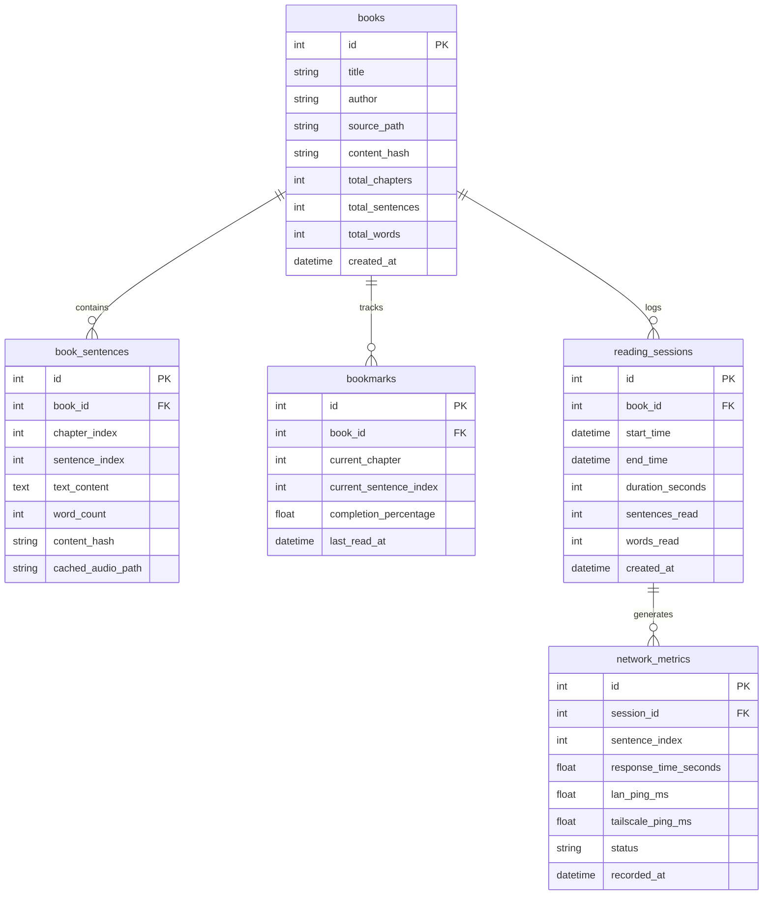

# Data Model & Interface Schemas: Decoupled Full-Stack Web Player

**Feature**: `002-fullstack-web-player`
**Date**: 2026-11-21
**Status**: Completed

---

## 1. Database Relational Entities (Core Engine)

The database schema is managed via SQLAlchemy connection pooling in `src/core/storage/` and initialized with `src/core/storage/migrations.py`.



---

## 2. API Request & Response Schemas (Pydantic v2 in `src/api/schemas/`)

### Book Ingestion & Catalog Schemas (`book_schemas.py`)

```python
from pydantic import BaseModel, Field

class BookSummaryResponse(BaseModel):
    id: int
    title: str
    author: str
    total_chapters: int
    total_sentences: int
    total_words: int
    created_at: str

class BookDetailResponse(BookSummaryResponse):
    source_path: str
    content_hash: str
    current_bookmark: BookmarkResponse | None = None

class BookSentenceResponse(BaseModel):
    sentence_index: int
    chapter_index: int
    text_content: str
    word_count: int

class BookSentencesListResponse(BaseModel):
    book_id: int
    total_sentences: int
    sentences: list[BookSentenceResponse]
```

### Player & Bookmark Schemas (`player_schemas.py`)

```python
class BookmarkResponse(BaseModel):
    book_id: int
    current_chapter: int
    current_sentence_index: int
    completion_percentage: float
    last_read_at: str | None = None

class BookmarkUpdateRequest(BaseModel):
    book_id: int
    current_chapter: int = Field(default=1, ge=1)
    current_sentence_index: int = Field(ge=0)
    completion_percentage: float = Field(ge=0.0, le=100.0)

class ReadingSessionCreateRequest(BaseModel):
    book_id: int
    duration_seconds: int = Field(ge=1)
    sentences_read: int = Field(ge=0)
    words_read: int = Field(ge=0)
    start_time: str
    end_time: str

class ReadingSessionResponse(BaseModel):
    id: int
    book_id: int
    duration_seconds: int
    sentences_read: int
    words_read: int
    created_at: str
```

### Analytics Schemas (`analytics_schemas.py`)

```python
class AnalyticsSummaryResponse(BaseModel):
    total_listening_minutes: float
    total_words_absorbed: int
    total_sessions: int
    avg_sentence_response_time_sec: float
    avg_lan_ping_ms: float
    avg_tailscale_ping_ms: float
    recent_sessions_count: int
```

---

## 3. Frontend TypeScript Interfaces (`frontend/src/types/`)

### `frontend/src/types/book.ts`
```typescript
export interface Book {
  id: number;
  title: string;
  author: string;
  total_chapters: number;
  total_sentences: number;
  total_words: number;
  created_at: string;
}

export interface BookSentence {
  sentence_index: number;
  chapter_index: number;
  text_content: string;
  word_count: number;
}
```

### `frontend/src/types/player.ts`
```typescript
export interface Bookmark {
  book_id: number;
  current_chapter: number;
  current_sentence_index: number;
  completion_percentage: number;
  last_read_at?: string;
}

export interface AudioPlayerState {
  isPlaying: boolean;
  isBuffering: boolean;
  currentIndex: number;
  speed: number;
  voice: string;
  lastLatencySec: number;
}
```

### `frontend/src/types/analytics.ts`
```typescript
export interface AnalyticsSummary {
  total_listening_minutes: number;
  total_words_absorbed: number;
  total_sessions: number;
  avg_sentence_response_time_sec: number;
  avg_lan_ping_ms: number;
  avg_tailscale_ping_ms: number;
  recent_sessions_count: number;
}
```
