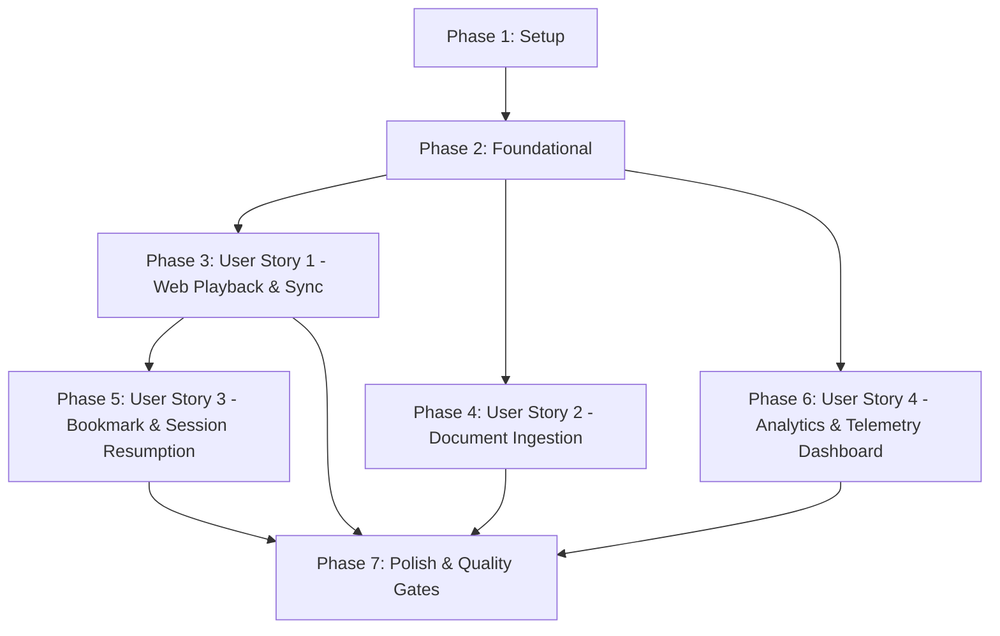

# Tasks: Decoupled Full-Stack Web Player

**Input**: Design documents from `specs/002-fullstack-web-player/`
**Prerequisites**: [plan.md](file:///home/hai/Du_lieu_hoc_tap/Project/BTL_Python_Project/StudyLab/specs/002-fullstack-web-player/plan.md), [spec.md](file:///home/hai/Du_lieu_hoc_tap/Project/BTL_Python_Project/StudyLab/specs/002-fullstack-web-player/spec.md), [research.md](file:///home/hai/Du_lieu_hoc_tap/Project/BTL_Python_Project/StudyLab/specs/002-fullstack-web-player/research.md), [data-model.md](file:///home/hai/Du_lieu_hoc_tap/Project/BTL_Python_Project/StudyLab/specs/002-fullstack-web-player/data-model.md), [contracts/](file:///home/hai/Du_lieu_hoc_tap/Project/BTL_Python_Project/StudyLab/specs/002-fullstack-web-player/contracts/)

**Tests**: Test tasks are included per Constitution Principle V (Test-First & Automated Verification) requiring deterministic, 100% offline test coverage.

**Organization**: Tasks are grouped by user story to enable independent implementation and testing of each story.

---

## Phase 1: Setup (Shared Infrastructure)

**Purpose**: Project initialization, dependency management, and frontend scaffolding.

- [x] T001 Update backend dependencies in pyproject.toml and requirements.txt to add flask and flask-cors
- [x] T002 [P] Reorganize backend domain logic into src/core/ package structure (src/core/ingestion, src/core/tts, src/core/storage, src/core/models, src/core/player, src/core/telemetry, src/core/config.py)
- [x] T003 [P] Initialize React SPA frontend directory in frontend/ using Vite, React 18, TypeScript, and configure frontend/vite.config.ts with API proxy to http://localhost:5000 and frontend/package.json
- [x] T004 [P] Configure frontend TypeScript compiler in frontend/tsconfig.json and define shared TypeScript interfaces in frontend/src/types/ (book.ts, player.ts, analytics.ts) matching contracts

---

## Phase 2: Foundational (Blocking Prerequisites)

**Purpose**: Core API application factory, schema validation, and base client infrastructure that MUST be complete before ANY user story can be implemented.

**⚠️ CRITICAL**: No user story work can begin until this phase is complete.

- [x] T005 Create Flask application factory in src/api/app.py with CORS configuration, centralized JSON error handlers, and blueprint registration
- [x] T006 [P] Create Pydantic v2 validation schemas in src/api/schemas/book_schemas.py, src/api/schemas/player_schemas.py, and src/api/schemas/analytics_schemas.py citing data-model.md: BookSummaryResponse, BookDetailResponse, BookSentenceResponse, BookmarkResponse, BookmarkUpdateRequest, ReadingSessionCreateRequest, AnalyticsSummaryResponse
- [x] T007 [P] Implement typed base API client and fetch wrapper in frontend/src/api/client.ts with error normalization and JSON parsing
- [x] T008 [P] Implement navigation header and layout in frontend/src/components/Navbar/Navbar.tsx and main routing setup in frontend/src/App.tsx

**Checkpoint**: Foundation ready — user story implementation can now begin.

---

## Phase 3: User Story 1 - Web Audio Playback & Real-Time Sentence Synchronization (Priority: P1) 🎯 MVP

**Goal**: Users can open any cataloged book, stream synthesized MP3 audio sentence-by-sentence with client-side lookahead buffering, and visually follow along with real-time sentence highlighting and keyboard controls.

**Independent Test**: Navigate to `http://localhost:5173/play/1`, verify sentence text renders with sentence 0 highlighted, audio plays within 1.5s, `[Space]` toggles pause, and clicking Next Sentence advances playback smoothly (<200ms gap).

### Tests for User Story 1

- [x] T009 [P] [US1] Write unit and contract tests in tests/unit/test_api_player.py verifying /api/audio/<book_id>/<sentence_index> audio streaming, mime-types, and query parameter validation
- [x] T010 [P] [US1] Write unit tests in tests/unit/test_api_books.py verifying GET /api/books/<book_id>/sentences returns indexed sentence list

### Implementation for User Story 1

- [x] T011 [P] [US1] Implement audio streaming Blueprint route in src/api/routes/player.py streaming discrete sentence MP3s via Core Engine AudioCacheManager and TTSFactory per contracts/rest-api-endpoints.md
- [x] T012 [P] [US1] Implement book sentences retrieval endpoint in src/api/routes/books.py (GET /api/books/<book_id>/sentences) with citations to data-model.md: BookSentence.book_id, BookSentence.chapter_index, BookSentence.sentence_index, BookSentence.text_content, BookSentence.word_count, BookSentence.content_hash
- [x] T013 [P] [US1] Implement player API client in frontend/src/api/playerApi.ts for fetching sentences and generating audio streaming URLs
- [x] T014 [US1] Implement useAudioPlayer custom hook in frontend/src/hooks/useAudioPlayer.ts managing dual HTML5 Audio instances for lookahead pre-fetch, speed control, and <200ms sentence transitions
- [x] T015 [P] [US1] Implement SentenceList component in frontend/src/components/Player/SentenceList.tsx rendering scrollable sentence items with active sentence visual highlighting
- [x] T016 [P] [US1] Implement PlayerControls and ProgressBar components in frontend/src/components/Player/PlayerControls.tsx and frontend/src/components/Player/ProgressBar.tsx supporting Play/Pause, Skip, and Speed adjustment
- [x] T017 [US1] Assemble PlayerPage in frontend/src/pages/PlayerPage.tsx integrating useAudioPlayer, SentenceList, and PlayerControls without exceeding 250 LOC

**Checkpoint**: User Story 1 is fully functional and testable independently (MVP ready!).

---

## Phase 4: User Story 2 - Web Document Ingestion & Library Cataloging (Priority: P1)

**Goal**: Users can upload `.txt` and `.md` book files through a web drag-and-drop interface, provide title and author metadata, monitor parsing progress, and browse their cataloged audiobook library.

**Independent Test**: Navigate to `http://localhost:5173/`, drag and drop `test_sample.txt`, enter Title and Author, submit, and verify the book card immediately appears in the library grid showing sentence and word count.

### Tests for User Story 2

- [x] T018 [P] [US2] Write integration tests in tests/integration/test_api_ingestion.py verifying multipart file upload, format validation (.txt/.md), and catalog listing

### Implementation for User Story 2

- [x] T019 [P] [US2] Implement book catalog and multipart upload routes in src/api/routes/books.py (GET /api/books and POST /api/books/ingest) delegating to Core Engine IngestionService with citations to data-model.md: Book.title, Book.author, Book.source_path, Book.total_chapters, Book.total_sentences, Book.total_words, Book.content_hash
- [x] T020 [P] [US2] Implement books API client in frontend/src/api/booksApi.ts supporting book listing and multipart file upload
- [x] T021 [P] [US2] Implement useBookCatalog custom hook in frontend/src/hooks/useBookCatalog.ts managing library state, loading, and file upload execution
- [x] T022 [P] [US2] Implement FileDropZone and BookUploaderModal components in frontend/src/components/BookUploader/FileDropZone.tsx and frontend/src/components/BookUploader/BookUploaderModal.tsx validating .txt/.md files
- [x] T023 [P] [US2] Implement BookCard component in frontend/src/components/Library/BookCard.tsx displaying book title, author, total sentences, words, and "Listen" action button
- [x] T024 [US2] Assemble LibraryPage in frontend/src/pages/LibraryPage.tsx presenting catalog grid, search filter, and upload modal without exceeding 250 LOC

**Checkpoint**: User Stories 1 and 2 are functional; users can upload and listen to books entirely in the browser.

---

## Phase 5: User Story 3 - Session Resumption & Persistent Bookmark Tracking (Priority: P2)

**Goal**: Automatically save the user's exact sentence position and reading duration to the database, and restore bookmark sentence index upon page reload or browser restart.

**Independent Test**: Listen to 5 sentences in the web player, refresh the browser tab, and verify the player automatically resumes from sentence 5 with accurate completion percentage.

### Tests for User Story 3

- [x] T025 [P] [US3] Write unit and contract tests in tests/unit/test_api_bookmarks.py verifying GET/POST /api/bookmarks and POST /api/sessions

### Implementation for User Story 3

- [x] T026 [P] [US3] Implement bookmark and session Blueprint routes in src/api/routes/player.py (GET /api/bookmarks/<id>, POST /api/bookmarks, POST /api/sessions) with citations to data-model.md: Bookmark.book_id, Bookmark.current_chapter, Bookmark.current_sentence_index, Bookmark.completion_percentage, ReadingSession.book_id, ReadingSession.start_time, ReadingSession.end_time, ReadingSession.duration_seconds, ReadingSession.sentences_read, ReadingSession.words_read
- [x] T027 [US3] Connect bookmark auto-save and initial position restoration in frontend/src/hooks/useAudioPlayer.ts syncing bookmark state to backend upon sentence completion or pause
- [x] T028 [US3] Implement session finalizer in frontend/src/hooks/useAudioPlayer.ts posting ReadingSessionCreateRequest upon page unload or navigation

**Checkpoint**: User Stories 1, 2, and 3 are functional; listening habits and bookmarks persist seamlessly.

---

## Phase 6: User Story 4 - Visual Analytics & Latency Telemetry Dashboard (Priority: P3)

**Goal**: Render high-contrast headless Matplotlib visual charts (`listening-trends.png`, `latency-metrics.png`) and KPI summary cards in a dedicated React analytics dashboard.

**Independent Test**: Navigate to `http://localhost:5173/dashboard`, verify that KPI metric cards display aggregated numbers and both Matplotlib chart images render with high contrast and readable legends.

### Tests for User Story 4

- [x] T029 [P] [US4] Write integration tests in tests/integration/test_api_analytics.py verifying /api/analytics/summary JSON schema and /api/analytics/charts/*.png binary image responses

### Implementation for User Story 4

- [x] T030 [P] [US4] Implement headless Matplotlib dashboard chart generators in src/core/analytics/dashboard.py using matplotlib.use('Agg') to render listening trends and network latency figures to in-memory io.BytesIO buffers
- [x] T031 [P] [US4] Implement analytics Blueprint routes in src/api/routes/analytics.py (GET /api/analytics/summary and GET /api/analytics/charts/<chart_type>.png) with citations to data-model.md: NetworkMetric.session_id, NetworkMetric.sentence_index, NetworkMetric.response_time_seconds, NetworkMetric.lan_ping_ms, NetworkMetric.tailscale_ping_ms, NetworkMetric.status
- [x] T032 [P] [US4] Implement analytics API client in frontend/src/api/analyticsApi.ts and useDashboard hook in frontend/src/hooks/useDashboard.ts
- [x] T033 [P] [US4] Implement MetricCard and ChartViewer components in frontend/src/components/Dashboard/MetricCard.tsx and frontend/src/components/Dashboard/ChartViewer.tsx
- [x] T034 [US4] Assemble DashboardPage in frontend/src/pages/DashboardPage.tsx displaying KPI summary grid and Matplotlib charts without exceeding 250 LOC

**Checkpoint**: All 4 user stories are fully implemented and testable.

---

## Phase 7: Polish & Cross-Cutting Concerns

**Purpose**: Integration script, line-count verification, end-to-end quickstart execution, and automated quality gates.

- [x] T035 [P] Create unified development startup script in package.json or bash script launching Flask API and Vite dev server concurrently
- [x] T036 Verify frontend file size constraint: ensure every file in frontend/src/ contains fewer than 250 LOC with zero monolithic files
- [x] T037 Run full quickstart.md validation scenario end-to-end against local server
- [x] T038 Run full offline test suite with ruff and mypy quality gates verifying zero errors and 100% test pass rate

---

## Dependencies & Execution Order

### Phase Dependencies

- **Phase 1 (Setup)**: Can start immediately.
- **Phase 2 (Foundational)**: Depends on Phase 1; BLOCKS all user stories.
- **Phase 3 (US1 - Playback)**: Depends on Phase 2. Delivers audio streaming and text sync (MVP!).
- **Phase 4 (US2 - Ingestion)**: Depends on Phase 2. Enables uploading books via web.
- **Phase 5 (US3 - Sessions/Bookmarks)**: Depends on Phase 3 (instruments web playback).
- **Phase 6 (US4 - Analytics Dashboard)**: Depends on Phase 2 (visualizes recorded sessions & metrics).
- **Phase 7 (Polish)**: Runs after desired user stories are complete.

### Parallel Opportunities

- **Setup Phase**: T002, T003, T004 can all run in parallel.
- **Foundational Phase**: T006, T007, T008 can run in parallel once T005 is established.
- **User Story 1**: T009 and T010 (tests) can run in parallel; T011, T012, T013, T015, T016 can run in parallel.
- **User Story 2**: T018 (tests), T019, T020, T021, T022, T023 can run in parallel.
- **User Story 3**: T025 (tests) and T026 can run in parallel.
- **User Story 4**: T028, T029, T030, T031, T032, T033 can run in parallel.
- **Polish Phase**: T035 can run in parallel with verification tasks.

---

## Implementation Strategy

### MVP First (User Story 1 Only)

1. Complete Phase 1: Setup (`T001` - `T004`)
2. Complete Phase 2: Foundational (`T005` - `T008`)
3. Complete Phase 3: User Story 1 (`T009` - `T017`)
4. **STOP and VALIDATE**: Open `http://localhost:5173/play/1` and verify sentence-synchronized audio playback.

### Incremental Delivery

1. Setup + Foundational → Backend factory, schemas, and frontend scaffold ready.
2. User Story 1 → Web sentence streaming and interactive player functional (MVP!).
3. User Story 2 → Drag-and-drop book upload and library cataloging functional.
4. User Story 3 → Exact bookmark retention and session recording functional.
5. User Story 4 → Headless Matplotlib analytics dashboard functional.
6. Polish → Verification scripts, LOC constraints, and full test suite passing.
